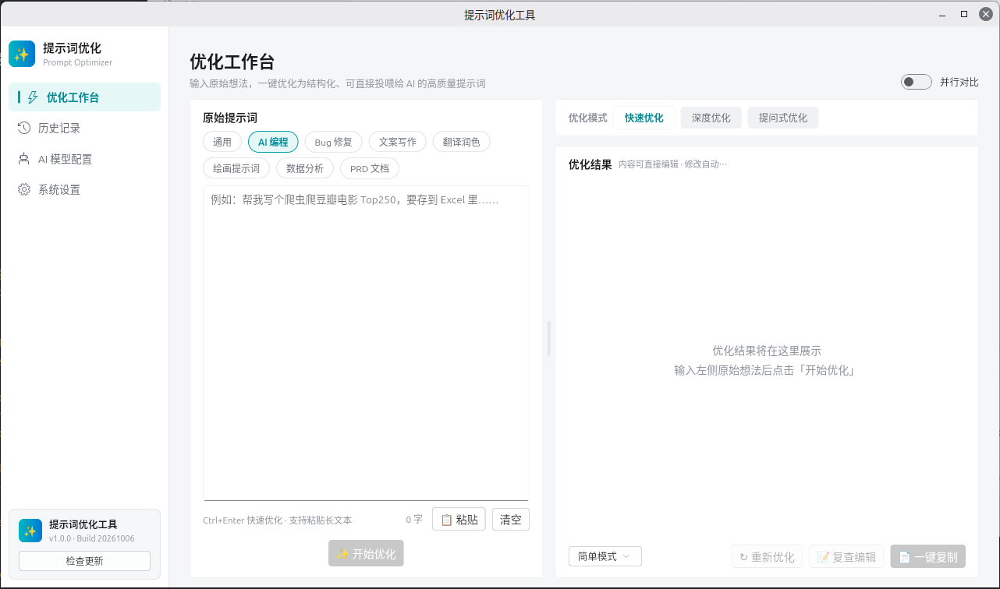
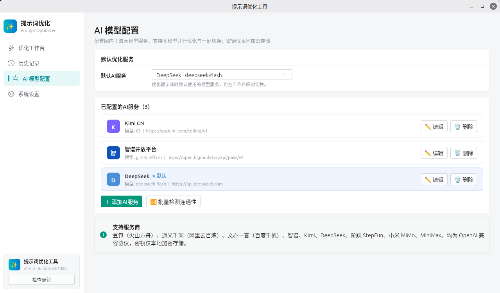
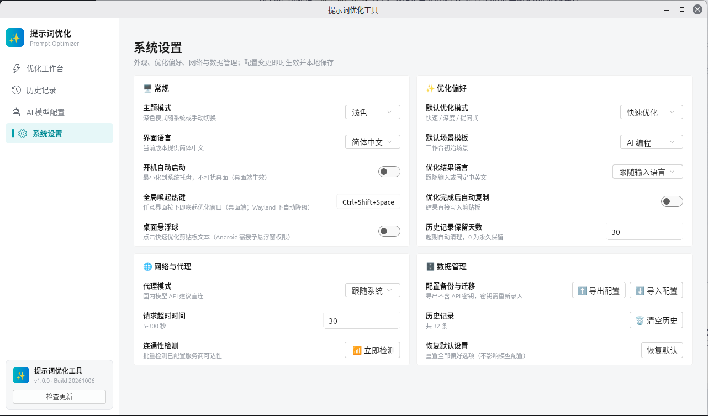

<p align="center">
  
</p>

<h1 align="center">提示词优化工具 Prompt Optimizer</h1>

<p align="center">
  跨平台 AI 提示词优化桌面应用 —— 输入原始想法，一键优化为结构化、可直接投喂 AI 的高质量提示词
</p>

<p align="center">
  
  
  
  
</p>

## 目录

- [界面预览](#界面预览)
- [功能特性](#功能特性)
- [支持的 AI 服务商](#支持的-ai-服务商)
- [技术栈](#技术栈)
- [快速开始](#快速开始)
- [项目结构](#项目结构)
- [文档](#文档)
- [已知边界](#已知边界)

## 界面预览

**优化工作台** —— 场景模板 + 原始提示词输入 → AI 流式优化 → 结果复查编辑 → 一键复制/导出

<p align="center">
  
</p>

**AI 模型配置** —— 多服务商管理、默认服务一键切换、批量连通性检测

<p align="center">
  
</p>

**系统设置** —— 常规 / 优化偏好 / 网络与代理 / 数据管理四组卡片，变更即时生效并本地保存

<p align="center">
  
</p>

## 功能特性

- ✨ **双输出风格** —— 简单模式（专业化重述，聚焦原始需求）与完整模式（角色定位/任务目标/具体要求等六段结构），可按次切换
- ⚡ **三种优化策略** —— 快速优化（默认）/ 深度优化 / 提问式优化，系统设置可配置默认模式
- 🔀 **多模型并行对比** —— 工作台一键开启，最多 3 家模型同时优化，双列结果对照，全部完成后支持逐列复查编辑
- 🧩 **九家国内主流大模型** —— 豆包、通义千问、文心一言、智谱、Kimi、DeepSeek、阶跃 StepFun、小米 MiMo、MiniMax；统一 OpenAI 兼容协议，Kimi/智谱额外支持 Coding Plan 双地址
- 🔐 **BYOK 密钥安全** —— API 密钥经 flutter_secure_storage 平台级加密存储；配置导出为 JSON 不含密钥，可安全备份迁移
- 🕘 **历史版本链** —— 每次优化与编辑留存版本，支持回滚、Markdown 导出、按模型/关键词筛选
- 📋 **场景模板** —— AI 编程 / Bug 修复 / 文案写作 / 翻译润色 / 绘画提示词 / 数据分析 / PRD 文档，按场景定制优化侧重点
- 🖥️ **真跨平台** —— Windows / Linux / Android 同一代码库；窄屏自动切换底部导航，主流分辨率下无溢出布局（全量布局巡检测试保障）

## 支持的 AI 服务商

| 服务商 | 接入方式 |
|---|---|
| 豆包（火山方舟） | OpenAI 兼容 |
| 通义千问（阿里云百炼） | OpenAI 兼容 |
| 文心一言（百度千帆） | OpenAI 兼容 |
| 智谱开放平台 | OpenAI 兼容 + Coding Plan 地址 |
| Kimi（月之暗面） | OpenAI 兼容 + Coding Plan 地址 |
| DeepSeek | OpenAI 兼容 |
| 阶跃 StepFun | OpenAI 兼容 |
| 小米 MiMo | OpenAI 兼容 |
| MiniMax | OpenAI 兼容 |

> 全部服务商均为 BYOK（Bring Your Own Key）模式，密钥仅本地加密存储，不上传任何服务器。

## 技术栈

Flutter 3.47+（Dart 3.13）· fluent_ui 桌面视觉 · dio SSE 流式解析 · SQLite 手写 DAO 本地存储 · flutter_secure_storage 密钥安全存储

## 快速开始

```bash
# 环境要求：Flutter SDK 3.47+（内含 Dart 3.13）

flutter pub get          # 拉取依赖

# 桌面端运行（按目标平台选择）
flutter run -d windows
flutter run -d linux

# Android 运行（-d 后接设备 ID，flutter devices 查看）
flutter run -d <device-id>

# 质量门禁
flutter test             # 299 项全量测试（单元 + Widget）
flutter analyze          # 静态分析，零告警

# 生产产物构建（标准 Flutter 命令）
flutter build windows --release
flutter build linux   --release
flutter build apk     --release    # 或 flutter build appbundle
```

## 项目结构

```
lib/
  core/        # 服务商配置表、模型规格库、数据模型、异常体系
  services/    # LLM 客户端(SSE)、优化引擎、并行调度、密钥库、存储、设置、导出
  state/       # 应用状态中枢（ChangeNotifier）
  ui/          # Fluent 桌面 UI：优化工作台 / 历史记录 / AI 模型配置 / 系统设置 / 复查编辑
test/
  unit/        # 单元测试（引擎/调度/存储/模型规格/资产校验 …）
  widget/      # Widget 测试（布局巡检、门槛逻辑、像素级对齐断言 …）
assets/icon/   # 应用图标母版（tool/gen_icon.py 可复现生成，四端资产同源）
docs/          # 实施文档、界面设计稿、测试报告、实现截图
screenshot/    # README 界面截图
```

## 已知边界

- Linux 桌面端 Wayland 下全局热键/剪贴板自动降级（应用内热键 + 引导文案）
- Android 悬浮球默认关闭，需用户手动授予悬浮窗权限
- Web 端仅作演示/验证形态（存储走 localStorage，密钥不持久化）
